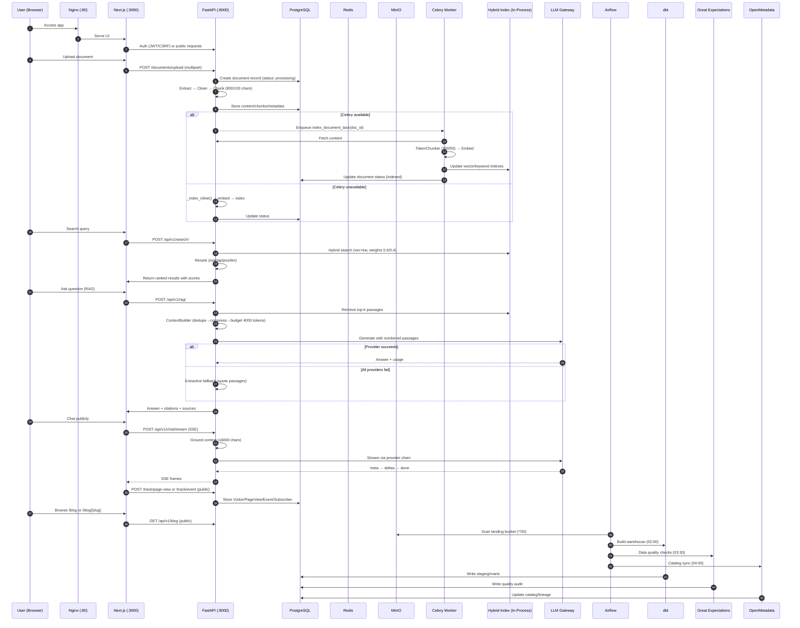
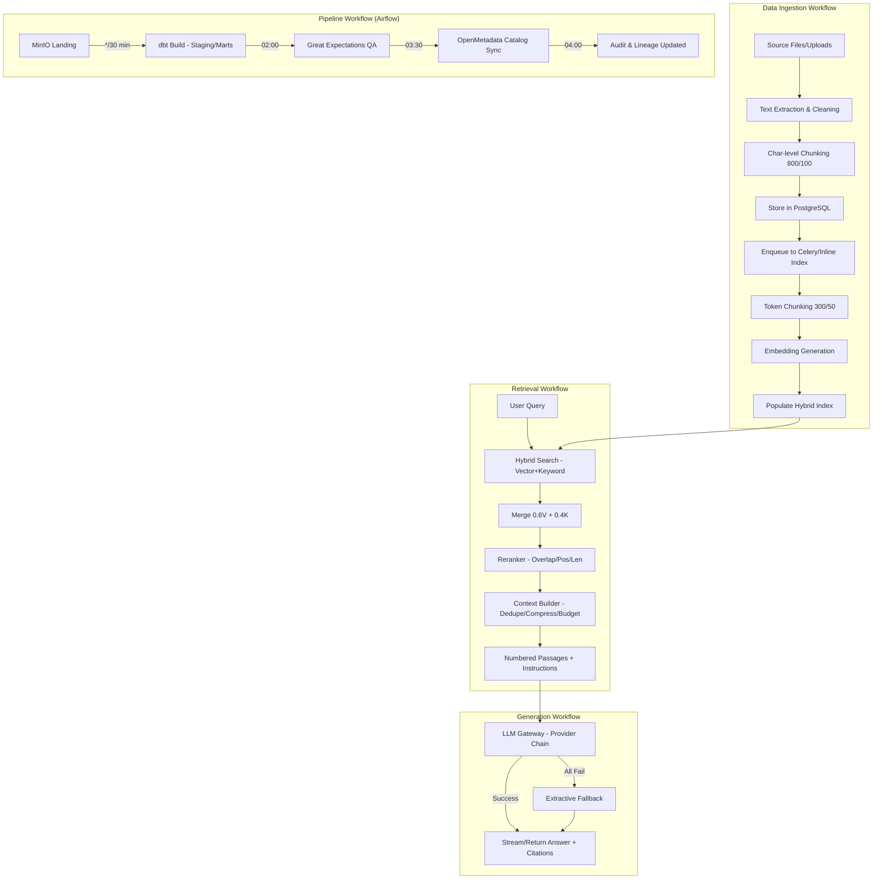
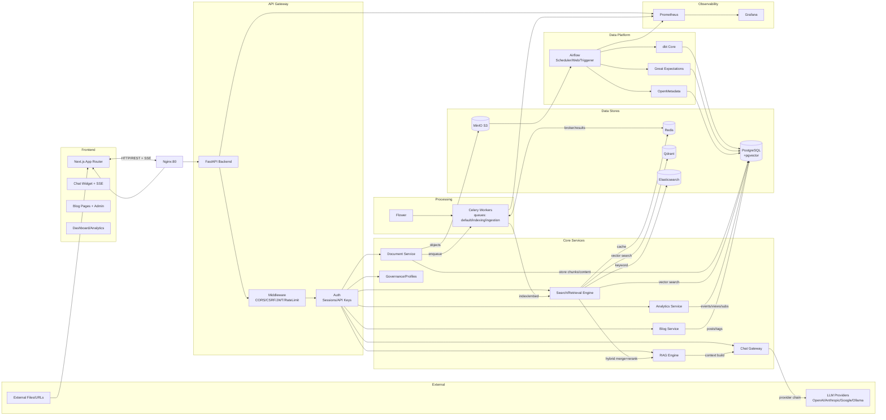
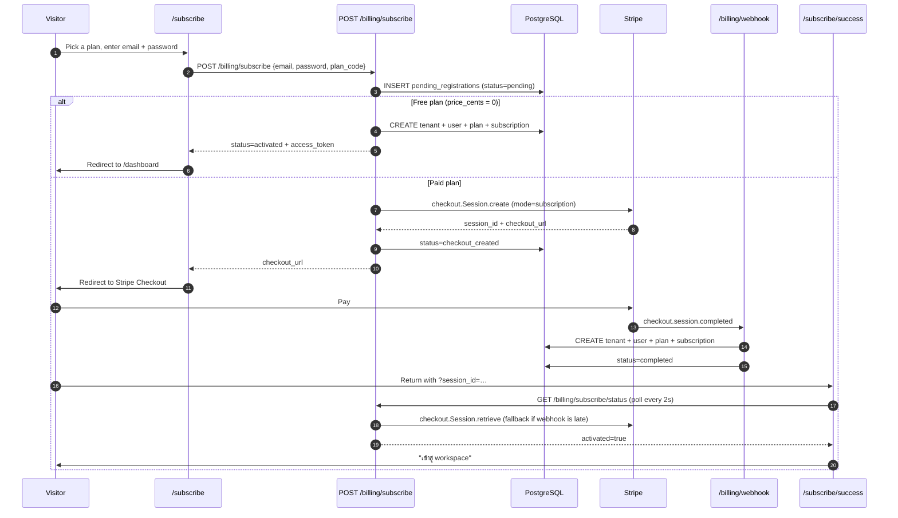

# DataAir

> 🌐 Live Demo: [https://maaelab-data-air.vercel.app/](https://maaelab-data-air.vercel.app/)

Enterprise Data Operating & Intelligence Platform — manages the complete data lifecycle from ingestion to AI agents.

## Features

- Unified ingestion from databases, warehouses and object stores
- Knowledge bases with versioning
- Hybrid search (semantic, vector, keyword)
- RAG with evaluation datasets
- Workflow orchestration with audit
- Data lineage
- Governance & audit with policy-as-code
- Analytics dashboards

## Tech Stack

- **Backend:** FastAPI, SQLAlchemy 2.0, Pydantic v2, Alembic
- **Frontend:** Next.js 14 (App Router), TypeScript, Tailwind CSS, shadcn/ui, TanStack Query, Recharts, React Flow
- **Database:** PostgreSQL 16 + pgvector
- **Search:** Hybrid (vector + keyword), Qdrant, Elasticsearch
- **Cache/Broker:** Redis, Celery + Flower
- **Storage:** MinIO (S3-compatible)
- **Orchestration:** Apache Airflow 2.x, dbt Core, Great Expectations
- **Catalog/Lineage:** OpenMetadata
- **AI/LLM:** OpenAI, Anthropic, Google Gemini, Ollama (multi-provider gateway with offline fallback)
- **Observability:** Prometheus, Grafana, OpenTelemetry (optional)
- **Content/Analytics:** React Markdown ecosystem, custom analytics API

## Quick Start

### Using Docker Compose (Recommended)
```bash
cp .env.example .env  # configure as needed
docker compose up -d
```

### Or run frontend/backend separately
```bash
# Backend
cd backend
pip install -r requirements.txt
uvicorn main:app --reload --port 8000

# Frontend
cd frontend
npm install
npm run dev
```

- Frontend: http://localhost:3000
- Backend API: http://localhost:8000 (docs at /docs)
- API Health: http://localhost:8000/health

## Tests

```bash
cd frontend && npm run lint && npm run typecheck && npm test
```

## License

See LICENSE.

## End-to-End System Flow

This diagram shows the complete journey from user interaction through document processing, indexing, search/RAG, and supporting data pipelines.



### Step-by-Step Explanation

1. **Access**: User hits site via Nginx; Next.js serves UI with auth via JWT/CSRF cookies.
2. **Upload**: Document uploaded → extracted/cleaned/chunked (char-level) → persisted to PostgreSQL.
3. **Indexing**: Celery worker (or inline fallback) tokenizes (300/50), embeds chunks, builds hybrid index (vector + keyword). Status tracked in DB.
4. **Search**: Hybrid retrieval merges scores (0.6 vector cosine + 0.4 keyword TF), reranks by overlap/position/length.
5. **RAG**: Top passages assembled with token budget, sent to LLM Gateway with citations instruction; degrades gracefully if no provider available.
6. **Chat**: Public SSE streaming with provider chain fallback; emits structured frames (meta/delta/done/error).
7. **Analytics/Blog**: Public endpoints track visitors/events/subscribers; blog serves published posts.
8. **Pipelines**: Airflow orchestrates MinIO ingestion → dbt transforms → GE validates → OM syncs catalog/lineage; all pipeline data lands in Postgres and is exposed via API/dashboard.

## Workflow Architecture (Component Workflow)



## 21. Tool Connectivity & Data Flow Diagram

### Complete System Integration Map



### Data Flow Description

1. **User Input → API**: Browser requests flow through Nginx to FastAPI with CORS/CSRF/JWT/API-key middleware enforcing auth and rate limits.
2. **Application Services → Storage**: Documents stored in PostgreSQL; objects in MinIO; embeddings/indexes in PG (pgvector), Qdrant, Elasticsearch; state/cache in Redis.
3. **Async Processing**: Heavy work (chunking/embedding/reindexing) enqueued to Celery workers (indexing/ingestion queues); Flower monitors.
4. **AI Path**: Search merges vector+keyword (hybrid) with reranking → ContextBuilder builds bounded context → LLM Gateway tries provider chain with offline fallback → SSE streams back.
5. **Platform Pipelines**: Airflow ingests from MinIO, triggers dbt transforms, runs GE quality checks, syncs metadata to OpenMetadata; all results persisted to Postgres for API consumption.
6. **Analytics/Content**: Public blog and analytics write/read tenant-scoped data; frontend dashboards visualize via API.
7. **Observability**: Prometheus scrapes metrics from API/workers/Airflow; Grafana visualizes.

### Integration Points Summary

| Integration | Direction | Protocol | Purpose |
|---|---|---|---|
| Browser ↔ Nginx/Frontend/API | Bidirectional | HTTP/HTTPS, SSE | UI, auth, chat streaming |
| API ↔ PostgreSQL | Read/Write | SQL (asyncpg) | Core data, vectors (pgvector), blog, analytics |
| API/Workers ↔ Redis | Read/Write | RESP | Broker, cache, rate limiting |
| API/Workers ↔ MinIO | Read/Write | S3 API | Object/file storage |
| Workers ↔ Qdrant/ES | Read/Write | HTTP | Vector/keyword indexes (secondary) |
| API ↔ LLM Providers | Request/Response (stream) | HTTP | Chat/RAG generation |
| Airflow ↔ MinIO/DB/OM/GE/dbt | Orchestrated | Various | ETL, QA, catalog, transforms |
| All → Prometheus/Grafana | Metrics | HTTP scrape | Observability |

## 22. Payment-Gated Signup (Subscribe Before Use)

A paid plan does not create an account. The workspace is opened only after the
payment is confirmed, so nobody can use the platform on a plan they have not
paid for.



### The rules it enforces

- **No account before payment.** A paid signup writes only a
  `pending_registrations` row. The user, tenant and subscription appear when
  Stripe confirms the payment.
- **The free plan skips the wait.** It activates in the same request and
  returns the session cookies, so there is no dead time for free users.
- **The webhook is the primary path; the status poll is the fallback.** A
  delayed or missed webhook still unblocks the user, because the poll asks
  Stripe directly.
- **Delivery is idempotent.** Stripe can deliver the same webhook twice. The
  second delivery finds the account already there and closes the
  registration instead of creating a second user.
- **The password is stored hashed on the pending row,** so the browser never
  has to resend it after the payment.

### Endpoints

| Endpoint | Auth | Purpose |
|---|---|---|
| `GET /api/v1/billing/public-plans` | public | Plan catalogue for the pricing page |
| `POST /api/v1/billing/subscribe` | public | Start a signup; returns a checkout URL or activates a free plan |
| `GET /api/v1/billing/subscribe/status` | public | Poll until the paid signup is activated |
| `POST /api/v1/billing/checkout` | user | Checkout for an already-registered user upgrading |
| `POST /api/v1/billing/portal` | user | Stripe customer portal |
| `POST /api/v1/billing/webhook` | Stripe signature | Stripe events, including the activation |

### Where the code lives

| Piece | Location |
|---|---|
| `PendingRegistration` model | `backend/app/models/billing.py` |
| Account activation (tenant + user + plan + subscription) | `backend/app/services/onboarding.py` |
| Subscribe, status and webhook handling | `backend/app/api/billing.py` |
| Schemas | `backend/app/schemas/__init__.py` (`SubscribeRequest`, `SubscribeResponse`, `SubscribeStatusResponse`, `PublicPlanResponse`) |
| Pricing page | `frontend/app/subscribe/page.tsx` |
| Payment status page | `frontend/app/subscribe/success/page.tsx` |
| API client | `frontend/lib/api/billing.ts` |

### Configuration

`STRIPE_SECRET_KEY`, `STRIPE_WEBHOOK_SECRET`, `STRIPE_SUCCESS_URL` and
`STRIPE_CANCEL_URL` drive the flow. `SAAS_PLANS` overrides the plan
catalogue, and every paid plan needs a `stripe_price_id` — the production
config check refuses to start without one.
