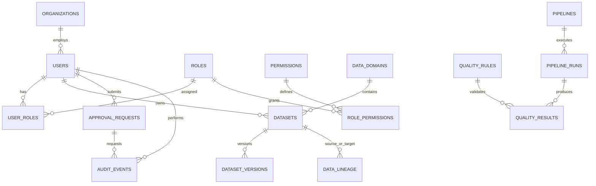

# Enterprise Data Platform สำหรับองค์กรขนาดกลาง

> Live Demo: [https://maaelab-data-air.vercel.app/](https://maaelab-data-air.vercel.app/)

**Hybrid Cloud Architecture · ISO Compliance · Production-Ready Design**

Enterprise Data Platform สำหรับบริษัทเอกชนขนาด 100–500 คน ออกแบบโดยยึดหลัก *Governance by Design*, *Security by Design* และ *Auditability by Design* เพื่อใช้เป็นศูนย์กลางการจัดการข้อมูล รองรับการทำงานระหว่าง On-Premises และ Cloud พร้อมเตรียมความพร้อมสำหรับการขอรับรองมาตรฐาน ISO

## สารบัญ

- [1. ข้อกำหนดและสมมติฐาน](#1-ข้อกำหนดและสมมติฐานในการออกแบบ)
- [2. ISO Standards Strategy](#2-iso-standards-strategy)
- [3. System Architecture](#3-system-architecture)
- [4. Technology Stack](#4-technology-stack)
- [5. Data Governance Framework](#5-data-governance-framework)
- [6. ISO Compliance Matrix และหลักฐานสำหรับการตรวจประเมิน](#6-iso-compliance-matrix-และหลักฐานสำหรับการตรวจประเมิน)
- [7. Database Schema](#7-database-schema)
- [8. RBAC และ Access Control Design](#8-rbac-และ-access-control-design)
- [9. API Design](#9-api-design)
- [10. Deployment Plan](#10-deployment-plan)
- [11. Test Plan](#11-test-plan)
- [12. Implementation Roadmap](#12-implementation-roadmap)
- [13. Governance Operating Model และการตรวจประเมิน](#13-governance-operating-model-และการตรวจประเมิน)
- [14. สรุปแบบก่อสร้างระบบ](#14-สรุปแบบก่อสร้างระบบ)
- [Quick Start (Development)](#quick-start-development)
- [License](#license)

## 1. ข้อกำหนดและสมมติฐานในการออกแบบ

- องค์กรมีระบบ ERP, CRM, ระบบบัญชี, HR, ไฟล์สำนักงาน และฐานข้อมูลแยกตามหน่วยงาน
- ต้องเก็บข้อมูลสำคัญไว้ในระบบที่องค์กรควบคุมได้ และใช้ Cloud สำหรับบริการที่เหมาะสม
- ผู้ใช้ทั่วไปไม่ควรเข้าถึงข้อมูลดิบหรือข้อมูลส่วนบุคคลได้โดยอัตโนมัติ
- ต้องติดตามแหล่งที่มาของข้อมูล การแปลงข้อมูล ผู้อนุมัติ และประวัติการเปลี่ยนแปลง (Data Lineage + Audit)
- ต้องรองรับข้อมูลเชิงวิเคราะห์และ AI ในอนาคต โดยไม่เปิดเผยข้อมูลเกินสิทธิ์
- ต้องสามารถตรวจสอบหลักฐานการทำงานย้อนหลังได้ ทั้งจากระบบและเอกสารควบคุม

> ตัวเลขขนาดข้อมูล จำนวนงานต่อวัน ปริมาณผู้ใช้พร้อมกัน ระยะเวลาสำรองข้อมูล และ SLA ยังต้องยืนยันจากการสำรวจระบบเดิมก่อนนำไปใช้กำหนดขนาดเซิร์ฟเวอร์หรือประมาณงบประมาณจริง

## 2. ISO Standards Strategy

### 2.1 มาตรฐานหลักและมาตรฐานสนับสนุน

| มาตรฐาน | สถานะ | ขอบเขตที่เกี่ยวข้อง |
| --- | --- | --- |
| **ISO/IEC 27001:2022** | มาตรฐานหลัก | ISMS, ความเสี่ยง, นโยบาย, การดำเนินงาน, Audit และการปรับปรุง |
| **ISO/IEC 27701:2025** | เป้าหมายเสริม | Privacy Information Management System (PIMS) สำหรับผู้ควบคุมและผู้ประมวลผลข้อมูลส่วนบุคคล |
| **ISO 8000 Series** | กรอบอ้างอิงด้าน Data Quality | คุณภาพข้อมูล การวัดผล และบทบาทความรับผิดชอบ |
| **ISO/IEC 11179 Series** | กรอบอ้างอิงด้าน Metadata | การลงทะเบียนและอธิบาย Metadata อย่างเป็นระบบ |
| **ISO 22301:2019** | เป้าหมายเสริม | Business Continuity Management System (BCMS) |
| **ISO/IEC 42001:2023** | พิจารณาเมื่อขยาย AI | ระบบบริหารจัดการ AI หากองค์กรพัฒนา ใช้ หรือให้บริการ AI อย่างมีนัยสำคัญ |

**แนวทางจัดลำดับ:** เริ่มจาก ISO/IEC 27001:2022 → ISO/IEC 27701:2025 → ISO 22301:2019 / ISO/IEC 42001:2023 ตามความจำเป็นและความเสี่ยง

> ISO 8000 และ ISO/IEC 11179 เป็นกรอบอ้างอิงสำหรับการออกแบบเท่านั้น ไม่ได้หมายความว่าองค์กรได้รับการรับรองเพียงเพราะมี Data Catalog หรือ Data Quality Tool

### 2.2 แยกข้อกำหนดมาตรฐานออกจากข้อเสนอทางเทคนิค

| มุมมอง | คำอธิบาย |
| --- | --- |
| **ISO (Requirements)** | ต้องมีขอบเขต, นโยบาย, บทบาท, ความเสี่ยง, วัตถุประสงค์, กระบวนการ, การประเมินผล, Internal Audit และการปรับปรุงตามมาตรฐานที่เลือก (ต้องอ้างอิงฉบับเต็ม) |
| **Design (Technical)** | การเลือก PostgreSQL, S3-compatible, OpenMetadata, Airflow, FastAPI, Keycloak, Terraform, Kubernetes เป็นการตัดสินใจด้านสถาปัตยกรรม ไม่ใช่ข้อบังคับของ ISO |
| **Evidence (Proof)** | ต้องมีหลักฐานการปฏิบัติจริง (Risk Register, Access Review, Restore Test, Incident Log, Internal Audit Report) มากกว่ามีเพียงเอกสารนโยบาย |

## 3. System Architecture

### 3.1 ภาพรวมสถาปัตยกรรม Hybrid Cloud

```text
Enterprise Users & Business Systems (ERP · CRM · Finance · HR · Sales · Operations · External APIs)
                ↓
        Identity & Secure Access (SSO · MFA · API Gateway · RBAC/ABAC)
                ↓
        ┌─────────────┬─────────────────┐
      On-Premises    │      Cloud      │
     (Sensitive     │  (Processing,   │
      & Controlled)  │   Lakehouse, BI)│
        └─────────────┴─────────────────┘
                ↓
        Enterprise Data Control Plane
        (Governance · Catalog · Metadata · Quality · Lineage · Audit · Policy)
                ↓
        Data Products & Consumption (BI · SQL · API · AI/RAG · Apps)
```

**หลักการสำคัญ:**
1. ไม่เปิดฐานข้อมูลภายในองค์กรให้เข้าถึงจาก Internet โดยตรง
2. ใช้ Site-to-Site VPN หรือ Private Connectivity
3. กำหนด Data Class ที่อนุญาตให้ประมวลผล/จัดเก็บใน Cloud
4. แยก Account/Subscription สำหรับ Dev/Staging/Prod/Security Logging
5. กำหนดขอบเขตความรับผิดชอบร่วม (องค์กร/Cloud Provider/ผู้ให้บริการภายนอก)
6. ทดสอบกรณี Cloud ขัดข้อง/เครือข่ายขาด/ซิงก์ล้มเหลว

### 3.2 แยก Control Plane และ Data Plane

| Plane | หน้าที่ | ตัวอย่างบริการ |
| --- | --- | --- |
| **Control Plane** | ควบคุมสิทธิ์, นโยบาย, การอนุมัติ, Metadata | FastAPI, PostgreSQL, Keycloak, Policy Service |
| **Data Plane** | รับส่ง, จัดเก็บ, แปลง, ให้บริการข้อมูล | Airflow, dbt, Object Storage, Apache Iceberg, Trino |
| **Security Plane** | ปกป้องและติดตามกิจกรรม | Firewall, IAM, KMS, Audit Logging, SIEM |
| **Observability Plane** | ตรวจสอบสถานะและประสิทธิภาพ | Prometheus, Grafana, OpenTelemetry |
| **Consumption Plane** | ให้บริการข้อมูลแก่ผู้ใช้ | BI, SQL Gateway, API, AI Services |

### 3.3 Network Zones

| Zone | สิทธิ์การเข้าถึง | การควบคุม |
| --- | --- | --- |
| **User Zone** | หน้าเว็บและ API ที่ได้รับอนุญาต | SSO, MFA, Rate Limit |
| **Application Zone** | เรียกใช้บริการภายใน | Service Identity, mTLS/TLS |
| **Data Processing Zone** | ประมวลผลตามงานที่อนุมัติ | Worker Isolation, Network ACL |
| **Storage Zone** | อ่าน/เขียนตาม Data Policy | Encryption at Rest/Transit, Storage Policy |
| **Management Zone** | ผู้ดูแลระบบ/CI-CD | Privileged Access, MFA, Approval |
| **Logging Zone** | รับ/จัดเก็บ Audit Logs | Restricted Access, Tamper Protection |
| **Recovery Zone** | ใช้กู้คืนระบบเมื่อเกิดเหตุ | แยก Credential, จำกัดขอบเขตการเข้าถึง |

## 4. Technology Stack

| Layer | เทคโนโลยีหลัก | เหตุผล |
| --- | --- | --- |
| **Frontend** | Next.js + TypeScript + Tailwind CSS + shadcn/ui | Admin Portal, Data Catalog UI |
| **API / Control Plane** | FastAPI + Pydantic v2 | API, Policy, Workflow, Validation |
| **Identity** | Keycloak หรือ Enterprise SSO (OIDC/SAML) | SSO, MFA, Federation |
| **Metadata DB** | PostgreSQL 16 | Transactional, Metadata, Audit References |
| **Object Storage** | S3-compatible (MinIO/AWS S3) | Raw data, Artifacts, Backups |
| **Lakehouse** | Apache Iceberg + Parquet | Schema Evolution, Time Travel, ACID-like |
| **Query Engine** | Trino | Cross-source SQL |
| **Transformation** | dbt Core | SQL Models, Tests, Documentation |
| **Orchestration** | Apache Airflow | DAGs, Retry, SLA, History |
| **Streaming** | Kafka/Redpanda (เมื่อจำเป็นจริง) | Event-driven use cases |
| **Data Catalog** | OpenMetadata | Catalog, Lineage, Ownership |
| **Data Quality** | Great Expectations / Soda Core | Validation, Data Docs |
| **BI** | Apache Superset | Dashboards, Reporting |
| **Observability** | Prometheus + Grafana + OpenTelemetry | Metrics/Logs/Traces |
| **Secrets** | HashiCorp Vault / Cloud Secrets Manager | Secure Secret Storage |
| **CI/CD** | GitHub Actions / GitLab CI | Build/Test/Scan/Deploy |
| **IaC** | Terraform + Docker/Kubernetes | Infra as Code, Containerization |

**แนวทางเลือกใช้:** เริ่มจาก PostgreSQL + Object Storage → เพิ่ม Trino/Iceberg เมื่อมีความจำเป็น → เลือก Catalog เดียวในช่วงแรก → ใช้ Managed Service ได้หากผ่านการประเมินความเสี่ยง

## 5. Data Governance Framework

### 5.1 โครงสร้างการกำกับดูแล

| บทบาท | ความรับผิดชอบ |
| --- | --- |
| **Executive Management** | อนุมัตินโยบาย, ความเสี่ยง, ทรัพยากร |
| **Data Governance Committee** | กำหนดมาตรฐาน, นิยามข้อมูล, อนุมัติข้อยกเว้น |
| **Data Owner** | รับผิดชอบข้อมูลและความเสี่ยงในโดเมนธุรกิจ |
| **Data Steward** | ดูแล Metadata, นิยาม, คุณภาพข้อมูล |
| **Platform Engineering** | สร้างระบบและบังคับใช้นโยบาย |
| **Security / Privacy** | ดูแลสิทธิ์, ข้อมูลส่วนบุคคล, เหตุการณ์ความมั่นคงปลอดภัย |

### 5.2 Data Domains

| Data Domain | ตัวอย่างข้อมูล | เจ้าของที่แนะนำ |
| --- | --- | --- |
| **Customer** | ลูกค้า, ติดต่อ, ประวัติการใช้บริการ | Sales/CRM Owner |
| **Finance** | รายรับ-รายจ่าย, บัญชี, ลูกหนี้ | Finance Owner |
| **Human Resources** | พนักงาน, ตำแหน่ง, เงินเดือน | HR Owner |
| **Sales** | คำสั่งซื้อ, รายได้, เป้าหมาย | Sales Owner |
| **Operations** | การผลิต/บริการ, สินค้าคงคลัง | Operations Owner |
| **Corporate Reference** | สาขา, แผนก, รหัสมาตรฐาน | Data Governance Lead |
| **Security & Audit** | การเข้าถึง, เหตุการณ์, หลักฐาน | Security Owner |

### 5.3 Data Classification

| ระดับ | ความหมาย | ตัวอย่าง | การควบคุม |
| --- | --- | --- | --- |
| **Public** | เปิดเผยได้ | รายงานสาธารณะที่อนุมัติ | ตรวจสอบก่อนเผยแพร่ |
| **Internal** | ใช้ภายในองค์กร | คู่มือ, รายงานทั่วไป | เข้าถึงผ่านบัญชีองค์กร |
| **Confidential** | ธุรกิจที่จำกัด | สัญญา, ต้นทุน, แผนธุรกิจ | จำกัดตามหน้าที่, Least Privilege |
| **Restricted** | ความอ่อนไหวสูง | ข้อมูลส่วนบุคคลสำคัญ, ข้อมูลการเงินละเอียดอ่อน | Least Privilege, MFA, Audit, มาตรการเพิ่มเติม |

### 5.4 Data Lifecycle Policy

ทุก Data Product ต้องมี: `data_owner_id`, `classification`, `source_system`, `purpose`, `retention_policy_id`, `quality_ruleset_id`, `approval_status`, `lineage_reference`, `last_reviewed_at`  
การลบข้อมูลต้องครอบคลุม Replicas, Derived Data, Export Files และข้อมูลที่ส่งต่อให้ผู้ประมวลผลภายนอก

## 6. ISO Compliance Matrix และหลักฐานสำหรับการตรวจประเมิน

### 6.1 ISO/IEC 27001:2022 Clause Mapping

| ข้อกำหนด | สิ่งที่ต้องดำเนินการ | หลักฐานที่ควรเตรียม |
| --- | --- | --- |
| **Clause 4 – Context** | กำหนดบริบท, ขอบเขต ISMS, ผู้มีส่วนได้ส่วนเสีย | Scope Statement, Context Analysis, Interested Parties Register |
| **Clause 5 – Leadership** | นโยบาย, บทบาท, ความรับผิดชอบ | Security Policy, Org Chart, Role Assignment |
| **Clause 6 – Planning** | ประเมินความเสี่ยง, วัตถุประสงค์ความปลอดภัย | Risk Register, Risk Treatment Plan, Security Objectives |
| **Clause 7 – Support** | ทรัพยากร, ความสามารถ, การสื่อสาร, เอกสาร | Training Records, Competency Matrix, Document Register |
| **Clause 8 – Operation** | ควบคุมความเสี่ยง, การเปลี่ยนแปลง | Change Tickets, Access Reviews, Pipeline Logs, Incident Records |
| **Clause 9 – Performance Evaluation** | ติดตาม, Internal Audit, Management Review | KPI Reports, Internal Audit Reports, Management Review Minutes |
| **Clause 10 – Improvement** | ข้อบกพร่อง, Root Cause, Corrective Action | Nonconformity Register, RCA, Corrective Action Evidence |

### 6.2 Annex A Control Mapping

| กลุ่ม | ตัวอย่างการนำไปใช้ | หลักฐาน |
| --- | --- | --- |
| **Organizational** | Policy, Roles, Supplier Security, Incident Management | นโยบาย, บทบาท, สัญญา, Supplier Assessment |
| **People** | Awareness, Training, Joiner/Mover/Leaver | Training, On/Offboarding Evidence |
| **Physical** | ห้อง Server, อุปกรณ์, สื่อสำรอง | Access Logs, Asset Inventory, Physical Review |
| **Technological** | IAM, Encryption, Logging, Backup, Secure Dev | Config, Test Reports, Audit Logs, Restore Reports |

ต้องจัดทำ **Statement of Applicability (SoA)** ระบุ Control ที่นำมาใช้/ไม่ใช้ เหตุผล และหลักฐานประกอบ

### 6.3 Evidence Register

| Evidence ID | หลักฐาน | เจ้าของ | รอบทบทวนที่เสนอ |
| --- | --- | --- | --- |
| EV-001 | ISMS Scope & Security Policy | Security Lead | เมื่อเปลี่ยนแปลง / ตามรอบทบทวน |
| EV-002 | Risk Assessment & Treatment Plan | Risk Owner | ตามรอบ / เมื่อมีการเปลี่ยนแปลงสำคัญ |
| EV-003 | Statement of Applicability | ISMS Owner | เมื่อมีการเปลี่ยนแปลงความเสี่ยง/Control |
| EV-004 | User Access Review | System Owner | รายไตรมาส (เริ่มต้น) |
| EV-005 | Security Incident Records | Security Team | ทุกเหตุการณ์ที่เข้าเกณฑ์ |
| EV-006 | Backup & Restore Test | Infrastructure Owner | ตามแผนกู้คืนที่อนุมัติ |
| EV-007 | Change Management Records | Platform Owner | ทุกการเปลี่ยนแปลงที่อยู่ในขอบเขตควบคุม |
| EV-008 | Internal Audit Report | Internal Auditor | ตาม Audit Programme |
| EV-009 | Management Review Minutes | Executive Sponsor | ตามรอบที่กำหนด |
| EV-010 | Corrective Action Register | Process Owner | ติดตามจนกว่าปิดประเด็น |

### 6.4 โครงสร้างโฟลเดอร์หลักฐาน

```text
compliance/
├── 00_scope_and_context/
├── 01_policies_and_procedures/
├── 02_risk_assessment/
├── 03_statement_of_applicability/
├── 04_asset_and_data_inventory/
├── 05_access_control/
├── 06_supplier_and_cloud_security/
├── 07_incident_management/
├── 08_change_and_release/
├── 09_backup_and_recovery/
├── 10_training_and_awareness/
├── 11_monitoring_and_kpi/
├── 12_internal_audit/
├── 13_management_review/
└── 14_corrective_actions/
```

เอกสารควบคุมต้องมีเลขที่, เวอร์ชัน, ผู้จัดทำ/ตรวจสอบ/อนุมัติ, วันที่มีผล, ประวัติการแก้ไข และหลักฐานดิจิทัลต้องมีแหล่งที่มา, สิทธิ์การเข้าถึงที่เหมาะสม

## 7. Database Schema

แยกเป็น 3 กลุ่ม: **Control DB** (ผู้ใช้/บทบาท/นโยบาย/Metadata/Audit), **Operational DB** (Pipeline/Quality/Workflow/Events), **Data Storage** (Object Storage/Lakehouse/Warehouse)

### 7.1 Core Entities



### 7.2 Core Tables (แนวคิด)

| ตาราง | หน้าที่ | ฟิลด์สำคัญ |
| --- | --- | --- |
| `organizations` | ข้อมูลองค์กร | id, name, status |
| `users` | ผู้ใช้งาน | id, organization_id, identity_subject, email, status |
| `roles` | บทบาท | id, organization_id, name, scope_type |
| `permissions` | สิทธิ์ | id, resource, action |
| `user_roles` | ความสัมพันธ์ผู้ใช้-บทบาท | user_id, role_id, scope_id, granted_by, granted_at, expires_at |
| `role_permissions` | สิทธิ์ของบทบาท | role_id, permission_id |
| `data_domains` | โดเมนข้อมูล | id, organization_id, name, owner_user_id |
| `datasets` | ทะเบียนชุดข้อมูล | id, organization_id, domain_id, owner_user_id, name, classification, status, retention_policy_id |
| `dataset_versions` | เวอร์ชันชุดข้อมูล | id, dataset_id, version_number, schema_hash, schema_definition(JSONB) |
| `pipelines` | นิยามงาน | id, organization_id, name, owner_user_id, definition(JSONB), status |
| `pipeline_runs` | ประวัติการรัน | id, pipeline_id, status, started_at, ended_at, error_code, metrics(JSONB) |
| `quality_rules` | กฎคุณภาพ | id, dataset_id, name, rule_type, definition(JSONB), severity, enabled |
| `quality_results` | ผลตรวจคุณภาพ | id, run_id, rule_id, status, metrics(JSONB), checked_at |
| `data_lineage` | Lineage | source_dataset_id, target_dataset_id, pipeline_id, transformation(JSONB) |
| `approval_requests` | คำขออนุมัติ | id, requester_id, resource_type, resource_id, status, decided_by, decided_at |
| `audit_events` | บันทึกเหตุการณ์ | id, organization_id, actor_subject, action, resource_type, resource_id, outcome, correlation_id, occurred_at, details(JSONB) |
| `evidence_records` | ทะเบียนหลักฐาน | id, evidence_type, owner_id, storage_ref, review_date, retention_until |

### 7.3 ข้อกำหนดเพิ่มเติมก่อน Production

- **Tenant Isolation:** ใช้ `organization_id` ร่วมกับ RLS หรือกลไกที่ผ่านการทดสอบ ห้ามพึ่งพาเพียงค่าที่ส่งมาจาก Request
- **user_roles:** ปรับ Primary Key/Unique Constraint ให้รองรับ `scope_id = NULL` ได้อย่างถูกต้อง
- **Indexes:** สร้าง Index ตาม query patterns ที่สำคัญ (`datasets(domain_id)`, `pipeline_runs(status,started_at)`, `audit_events(occurred_at)`)
- **Least Privilege DB:** แอปพลิเคชัน Production ไม่ควรใช้บัญชี Superuser
- **Audit Immutability:** บันทึก Audit สำคัญส่งไปยังพื้นที่แยก มีการควบคุมการลบ/แก้ไข
- **Migrations:** ใช้ระบบ Migration ที่ versionable และ reviewable
- **Retention:** กำหนดนโยบายเก็บรักษาและการลบอย่างเป็นระบบ

## 8. RBAC และ Access Control Design

### 8.1 บทบาทมาตรฐาน

| Role | สิทธิ์หลัก | ข้อจำกัด |
| --- | --- | --- |
| **platform_admin** | ดูแล Configuration/บริการแพลตฟอร์ม | ไม่ได้อ่านข้อมูลธุรกิจทั้งหมดโดยอัตโนมัติ |
| **security_admin** | จัดการ Security Policy, Audit, Incident | การเปลี่ยนสิทธิ์สำคัญต้องผ่าน Audit |
| **data_governance_lead** | Governance, Classification, Metadata Policy | ไม่แก้ไขข้อมูลต้นทางโดยไม่มีสิทธิ์ |
| **data_owner** | อนุมัติการเผยแพร่/การใช้ข้อมูลในโดเมน | จำกัดตามโดเมนที่รับผิดชอบ |
| **data_steward** | Metadata, Data Quality Rules | ไม่สามารถอนุมัติคำขอของตนเอง |
| **data_engineer** | สร้าง/รัน Pipeline | จำกัดการเข้าถึงข้อมูล Restricted |
| **data_analyst** | Query ชุดข้อมูลที่ได้รับอนุมัติ | จำกัดตาม Dataset/Column Policy |
| **auditor** | อ่านหลักฐานและ Audit Logs (Read-only) | ห้ามแก้ไขหลักฐาน/Audit |
| **business_user** | ใช้ Dashboard/Data Products ที่ได้รับสิทธิ์ | ไม่สามารถจัดการ Governance Policy |
| **service_account** | ทำงานอัตโนมัติตามขอบเขต | Credential เฉพาะงาน, ห้าม Interactive Login |

### 8.2 หลักการบังคับใช้สิทธิ์

1. **Deny by Default** – ปฏิเสธถ้าไม่มี Permission ตรงกับ Resource/Action/Scope
2. **Least Privilege** – ให้สิทธิ์เท่าที่จำเป็น
3. **Separation of Duties** – ผู้ร้องขอไม่ควรอนุมัติคำขอของตนเอง
4. **Privileged Access** – ต้องใช้ MFA + Audit Trail
5. **Service Identity** – แต่ละงานใช้ Service Account แยกตามขอบเขต
6. **Data-level Security** – Column Masking, Row Filtering, Export Restrictions
7. **Access Recertification** – ทบทวนสิทธิ์รายไตรมาส/เมื่อย้ายตำแหน่ง/ลาออก
8. **Emergency Access** – ควบคุม, ต้องมีการอนุมัติและตรวจสอบย้อนหลัง
9. **Policy Enforcement** – บังคับใช้ที่ API, Query Gateway, Storage Access Layer (ไม่พึ่งแค่ UI)

## 9. API Design

### 9.1 API Modules

| Module | Prefix | ความรับผิดชอบ |
| --- | --- | --- |
| Identity | `/api/v1/identity` | Session, Claims |
| Users & Roles | `/api/v1/users`, `/api/v1/roles` | ผู้ใช้, บทบาท, สิทธิ์ |
| Data Catalog | `/api/v1/datasets` | ลงทะเบียน/ค้นหาชุดข้อมูล |
| Domains | `/api/v1/domains` | Data Domain, Data Owner |
| Data Sources | `/api/v1/sources` | แหล่งข้อมูล, Secret Reference |
| Pipelines | `/api/v1/pipelines` | นิยามงาน, สั่งรัน |
| Data Quality | `/api/v1/quality` | กฎ/ผลตรวจคุณภาพ |
| Lineage | `/api/v1/lineage` | ความสัมพันธ์ข้อมูล |
| Approvals | `/api/v1/approvals` | คำขออนุมัติ/ตัดสินใจ |
| Governance | `/api/v1/governance` | Policy, Classification, Retention |
| Audit | `/api/v1/audit-events` | ค้นหา Audit Events |
| Evidence | `/api/v1/evidence` | ทะเบียนหลักฐาน |
| Operations | `/api/v1/operations` | Health, Jobs, Metrics |

### 9.2 ตัวอย่าง Endpoint

| Method | Endpoint | Permission | คำอธิบาย |
| --- | --- | --- | --- |
| `GET` | `/api/v1/datasets` | `dataset:read` | ค้นหาชุดข้อมูล |
| `POST` | `/api/v1/datasets` | `dataset:create` | ลงทะเบียนชุดข้อมูล |
| `GET` | `/api/v1/datasets/{id}` | `dataset:read` + Scope | รายละเอียดชุดข้อมูล |
| `PATCH` | `/api/v1/datasets/{id}` | `dataset:update` + Scope | แก้ไข Metadata |
| `POST` | `/api/v1/datasets/{id}/submit` | `dataset:submit` | ส่งขออนุมัติ |
| `POST` | `/api/v1/datasets/{id}/approve` | `dataset:approve` + Scope | อนุมัติเผยแพร่ |
| `POST` | `/api/v1/pipelines/{id}/runs` | `pipeline:execute` | สั่งรัน Pipeline |
| `GET` | `/api/v1/pipelines/{id}/runs/{run_id}` | `pipeline:read` | สถานะการรัน |
| `GET` | `/api/v1/datasets/{id}/lineage` | `lineage:read` | Data Lineage |
| `GET` | `/api/v1/datasets/{id}/quality-results` | `quality:read` | ผลตรวจคุณภาพ |
| `GET` | `/api/v1/audit-events` | `audit:read` | ค้นหา Audit Events |
| `GET` | `/api/v1/evidence` | `evidence:read` | ค้นหาหลักฐาน |

### 9.3 ข้อกำหนด API

- **TLS** ทุก Request
- **Token Validation** ผ่าน Identity Provider (OIDC)
- **Authorization** ฝั่ง Server ทุก Request
- **Pagination/Filtering/Rate Limiting/Request Size Limits**
- **Idempotency-Key** สำหรับคำสั่งที่อาจเรียกซ้ำ
- **Correlation ID** เชื่อมโยง Request/Job/Audit
- **Secure Error Format** ไม่เปิดเผยรายละเอียดภายใน
- **Input Validation** ป้องกัน Injection/Mass Assignment/Broken Access Control
- **Async Jobs** สำหรับงานหนัก + Job Status Endpoint
- **Audit Critical Actions** โดยไม่บันทึก Secret/Token/PII เกินจำเป็น

**Error Format ตัวอย่าง:**

```json
{
  "error": {
    "code": "DATASET_ACCESS_DENIED",
    "message": "You are not authorized to access this dataset.",
    "correlation_id": "uuid",
    "details": []
  }
}
```

## 10. Deployment Plan

### 10.1 Environment Strategy

| Environment | วัตถุประสงค์ |
| --- | --- |
| **Development** | พัฒนา Feature, Unit Test, Synthetic Data |
| **CI Pipeline** | Lint, Test, SAST, Dependency/Image Scan, Build |
| **Staging/UAT** | Integration, Security, UAT, Pre-Release Approval |
| **Production** | Controlled Release, Monitoring, Backup, Incident Response, Audit |

การ Release ต้องผ่าน Artifact ที่ทดสอบแล้ว และมี **Emergency Change Procedure** แยกต่างหาก

### 10.2 Repository Structure

```text
enterprise-data-platform/
├── apps/web-portal/        # Next.js Admin Portal
├── apps/control-api/       # FastAPI Control Plane
├── services/               # Governance/Metadata/Policy/Approval/Audit
├── data-platform/          # Ingestion/Transformations/Quality/Lineage
├── database/migrations/    # Schema migrations
├── infrastructure/         # Docker/Terraform/Network/Monitoring
├── security/               # Threat Model/Security Tests/Access Policies
├── compliance/             # Policies/Procedures/Evidence/Audit Templates
├── tests/                  # Unit/Integration/Security/Perf/DR
└── docs/                   # Architecture/API/Runbooks/User Guides
```

### 10.3 ขนาดระบบเริ่มต้น (Capacity Planning)

| ส่วนระบบ | ทรัพยากรเริ่มต้นที่เสนอ |
| --- | --- |
| Control API / Web Portal | 2–4 vCPU, 4–8 GB RAM |
| PostgreSQL Control DB | 4 vCPU, 16 GB RAM, SSD + สำรองพื้นที่ |
| Data Workers | 4–8 vCPU, 16–32 GB RAM (ปรับตามงาน) |
| Object Storage | เริ่ม 1–5 TB usable, วัดอัตราการเติบโต |
| Monitoring/Logging | 2–4 vCPU, 8–16 GB RAM |
| Network | VPN/Private Connectivity ตาม Throughput/Latency ที่วัดได้ |

> ต้องทำ Load Test, ประเมินอัตราการเติบโต, เผื่อ Replicas/Versions/Backups ก่อนสั่งซื้อจริง

### 10.4 Backup & Disaster Recovery

| ระบบ | RPO (ตัวอย่าง) | RTO (ตัวอย่าง) |
| --- | --- | --- |
| Control Database | ≤ 15 นาที | ≤ 4 ชั่วโมง |
| Metadata & Catalog | ≤ 1 ชั่วโมง | ≤ 4 ชั่วโมง |
| Critical Data Products | ≤ 1 ชั่วโมง | ≤ 8 ชั่วโมง |
| Historical Raw Data | ตามนโยบาย | ≤ 24 ชั่วโมง |

**มาตรการ:** PostgreSQL PITR, Object Versioning, สำเนา Backup แยก Failure Domain, จำกัดสิทธิ์ลบ, Encryption + Key Management, ทดสอบ Restore เป็นระยะ, Runbook สำหรับ Outage/Ransomware/Credential Compromise

## 11. Test Plan

### 11.1 Test Matrix

| Test Type | รายการทดสอบ | เกณฑ์ผ่านที่เสนอ |
| --- | --- | --- |
| **Unit Test** | Business Logic, Validation, Policy Evaluation | ผ่าน Critical Tests ครบถ้วน |
| **Integration Test** | API, DB, Identity, Storage | Workflow สำคัญผ่านครบ |
| **RBAC Test** | อ่าน/เขียน/อนุมัติ/ข้าม Scope | ไม่มี Unauthorized Access ที่ยังไม่แก้ไข |
| **Tenant Isolation** | ข้ามองค์กร/ข้าม Scope | ปฏิเสธทุกกรณีที่ไม่ได้รับอนุญาต |
| **Data Quality** | Null/Duplicate/Schema Drift/Referential Integrity | กฎ Critical ผ่านตามที่กำหนด |
| **Lineage Test** | Source → Transform → Target | ชุดข้อมูลสำคัญมี Lineage ครบ |
| **Security Test** | SAST/Dependency/DAST/Secret Scan | ไม่มี Critical/High ที่ยังไม่แก้ไขหรือไม่มีการอนุมัติข้อยกเว้น |
| **Performance Test** | Concurrent/Query/Pipeline Throughput | ผ่าน SLA/SLO ที่อนุมัติ |
| **Resilience Test** | Worker/Network Failure + Retry | กู้คืนได้ ไม่ทำให้ข้อมูลเสียหาย |
| **Backup/Restore Test** | DB + Object Storage | ผ่าน RPO/RTO ที่กำหนด |
| **Audit Test** | เหตุการณ์ย้อนหลัง ตรวจสอบได้ | เหตุการณ์สำคัญเชื่อมโยงได้, หลักฐาน Immutable |
| **UAT** | ทดสอบโดยผู้ใช้งานจริง | Business Owner อนุมัติ |

### 11.2 Acceptance Tests (ตัวอย่าง)

| ID | สถานการณ์ | เกณฑ์ยอมรับ |
| --- | --- | --- |
| AT-01 | Access Control | ผู้ใช้ Sales ไม่สามารถอ่านชุดข้อมูลเงินเดือนใน Restricted Domain แม้รู้ Dataset ID |
| AT-02 | Data Lineage | Pipeline สามารถย้อนกลับไปดู Source Version และ Output Version ได้ |
| AT-03 | Approval Workflow | Dataset Draft ไม่ปรากฏเป็น Certified Data Product จนกว่าผู้มีสิทธิ์อนุมัติครบถ้วน |
| AT-04 | Data Quality | เมื่อไม่ผ่าน Critical Rule ต้อง Quarantine/หยุดเผยแพร่และแจ้งผู้รับผิดชอบ |
| AT-05 | Audit Evidence | ค้นหาได้ว่าใครเปลี่ยนสิทธิ์/เมื่อใด/ใครอนุมัติ โดย Auditor อ่านได้อย่างเดียว |
| AT-06 | Recovery | กู้คืนภายใน RTO, ข้อมูลสูญเสียไม่เกิน RPO |

**Test Evidence ต้องมี:** Test Case ID, Tester, Environment, Version, Expected/Actual, Pass/Fail, Defect ID, หลักฐาน (Log/Report/Screenshot)

## 12. Implementation Roadmap

| Phase | ระยะเวลา | เป้าหมายหลัก | Deliverable |
| --- | --- | --- | --- |
| **Phase 1** | เดือน 1 | Assessment & ISO Gap Analysis, ขอบเขต ISMS, ความเสี่ยง | Scope, Risk Register, Target Architecture, ADRs |
| **Phase 2** | เดือน 2 | Hybrid Foundation, Network Segmentation, IAM/MFA/Secrets/Logging, Backup/CI-CD | Infra Baseline, IAM, Deployment Pipeline |
| **Phase 3** | เดือน 3 | Control Plane, Users/Roles/Permissions, Data Catalog, Approval Workflow | Core API, RBAC, Metadata Registry |
| **Phase 4** | เดือน 4 | Data Ingestion, Object Storage, Lakehouse, Transform, Schema Validation | Data Pipeline, Storage, Ops Monitoring |
| **Phase 5** | เดือน 5 | Governance, Classification, Data Quality, Lineage, Policy Enforcement, Retention | Governance Framework, Quality, Lineage |
| **Phase 6** | เดือน 6 | Certified Data Products, BI, Data Access API, UAT | Business Data Products, BI, UAT Results |
| **Phase 7** | เดือน 7 | Security/Perf Validation, Backup/Restore, Incident Response, Runbooks, Evidence | Test Reports, Recovery Evidence, Runbooks |
| **Phase 8** | เดือน 8 | Internal Audit, Corrective Action, Management Review, Readiness Assessment | Audit Report, CAPA, Certification Readiness |

### 12.1 Stage Gates

| Gate | เกณฑ์ผ่าน |
| --- | --- |
| **Gate A – Functional** | Features ทำงานตาม Requirement, ผ่าน Test Cases |
| **Gate B – Security** | ไม่มี Critical/High ที่ยังไม่แก้ไข หรือมีข้อยกเว้นที่อนุมัติอย่างเป็นทางการ |
| **Gate C – Data Integrity** | ข้อมูลถูกต้อง, ไม่ซ้ำจาก Retry, ผ่าน Data Quality Rules |
| **Gate D – Operations** | มี Monitoring, Runbook, Backup, ผู้รับผิดชอบชัดเจน |
| **Gate E – Compliance** | มีเอกสาร/หลักฐานครบตาม Phase นั้น |

### 12.2 ทีมงานที่เสนอ

| บทบาท | จำนวน | ช่วงที่ใช้ |
| --- | --- | --- |
| Project Manager / Business Analyst | 1 | ตลอดโครงการ |
| Solution/Data Architect | 1 | ออกแบบ & ควบคุมสถาปัตยกรรม |
| Data Engineer | 2 | Pipeline & Data Products |
| Backend Engineer | 1–2 | Control API & Governance |
| Frontend Engineer | 1 | Portal & Dashboard |
| DevOps/Platform Engineer | 1 | Infra, CI/CD, Operations |
| Security/Compliance Specialist | 1 | ความเสี่ยง & หลักฐาน |
| Data Owner/Business SME | Part-time | Requirements & Data Acceptance |
| Internal Auditor | ตามแผน | ตรวจสอบอย่างอิสระ |

> หลีกเลี่ยงให้ผู้พัฒนาตรวจสอบผลงานของตนเองในกิจกรรมที่ต้องการความเป็นอิสระ

## 13. Governance Operating Model และการตรวจประเมิน

### 13.1 รอบการบริหารจัดการ

| ความถี่ | กิจกรรม | ผู้รับผิดชอบ |
| --- | --- | --- |
| **รายวัน** | Pipeline, Failed Jobs, Security Alerts, Storage Health | Ops/Data Engineering |
| **รายสัปดาห์** | คุณภาพข้อมูล, งานค้าง, เหตุการณ์สำคัญ | Data Steward/Platform Team |
| **รายเดือน** | KPI, ความเสี่ยง, การเปลี่ยนแปลง, การใช้ทรัพยากร | Data Governance Lead |
| **รายไตรมาส** | ทบทวนสิทธิ์, ชุดข้อมูลสำคัญ, นโยบาย | System Owner/Security |
| **ตามแผน Audit** | ตรวจสอบกระบวนการและหลักฐานอย่างอิสระ | Internal Auditor |
| **ตามรอบ Management Review** | ผลการดำเนินงาน, ความเสี่ยง, การปรับปรุง | ผู้บริหาร |

### 13.2 เส้นทางสู่การขอใบรับรอง ISO/IEC 27001

1. กำหนดขอบเขต ISMS และหน่วยงาน/ระบบที่อยู่ในขอบเขต
2. ดำเนิน Risk Assessment และจัดทำ Risk Treatment Plan
3. จัดทำ Statement of Applicability และนำมาตรการที่เลือกไปใช้
4. เก็บหลักฐานการดำเนินงานจริง (Access Review, Restore Test, Incidents, Changes)
5. ดำเนิน Internal Audit และ Management Review
6. ปิดข้อบกพร่อง (Corrective Action) จนพร้อม
7. ประสาน Certification Body ที่ได้รับการรับรองและเหมาะสมกับขอบเขต

> ผ่านการทดสอบเทคนิคหรือมีเอกสารครบ ไม่ได้หมายความว่าจะได้รับใบรับรองเสมอไป ผู้ตรวจประเมินเน้น **การดำเนินงานจริง**, **ประสิทธิผลของระบบบริหารจัดการ** และ **หลักฐานตามขอบเขตที่กำหนด**

## 14. สรุปแบบก่อสร้างระบบ

แบบนี้เป็น **Blueprint สำหรับพัฒนาระบบจริง** ครอบคลุม:

- **Architecture:** Hybrid Cloud, Control/Data/Security/Observability/Consumption Planes, Secure Zones
- **Data Foundation:** PostgreSQL, Object Storage, Lakehouse (Iceberg), Orchestration (Airflow), Catalog (OpenMetadata), Quality, Lineage
- **Security & Governance:** SSO/MFA, RBAC, Classification, Policy Enforcement, Audit Trail, Retention, Approval Workflow
- **ISO Readiness:** Risk Register, SoA, Evidence Register, Internal Audit, CAPA, Management Review
- **Implementation:** Roadmap 8 เดือน, Stage Gates, Test Plan, Deployment Controls, Acceptance Criteria

**ขั้นตอนแนะนำก่อนเริ่มเขียนโค้ด:** ดำเนิน Phase 1 ให้เสร็จและจัดทำเอกสารต่อไปนี้ภายใต้ Version Control (มีผู้อนุมัติ + ผูกกับ Requirement/Test/Evidence ID):

1. `docs/architecture/SYSTEM_ARCHITECTURE.md`
2. `docs/architecture/TECHNOLOGY_STACK.md`
3. `docs/governance/DATA_GOVERNANCE_POLICY.md`
4. `docs/compliance/ISO_COMPLIANCE_MATRIX.md`
5. `database/schema/DATABASE_SCHEMA.sql`
6. `docs/security/RBAC_MATRIX.md`
7. `docs/api/API_SPECIFICATION.yaml`
8. `docs/operations/DEPLOYMENT_RUNBOOK.md`
9. `docs/testing/TEST_PLAN.md`
10. `docs/roadmap/IMPLEMENTATION_ROADMAP.md`

> การออกแบบนี้เป็น Blueprint สำหรับนำไปพัฒนาต่อ ไม่ใช่การยืนยันว่าระบบได้รับการรับรอง ISO แล้ว ควรตรวจสอบข้อกำหนดฉบับเต็มกับ Certification Body ที่เลือกก่อนยื่นขอใบรับรอง

## Quick Start (Development)

### Using Docker Compose (Recommended)
```bash
cp .env.example .env  # configure as needed
docker compose up -d
```

### Run frontend/backend separately
```bash
# Backend
cd backend
pip install -r requirements.txt
uvicorn main:app --reload --port 8000

# Frontend
cd frontend
npm install
npm run dev
```

- Frontend: http://localhost:3000
- Backend API: http://localhost:8000 (Swagger Docs: /docs, ReDoc: /redoc)
- Health: http://localhost:8000/health

### Tests
```bash
cd frontend && npm run lint && npm run typecheck && npm test
cd .. && python -m pytest -q
```

## License

See [LICENSE](./LICENSE).

### Data Governance & Security
- **Apache Ranger**: Centralized security administration, fine-grained access control, and audit
